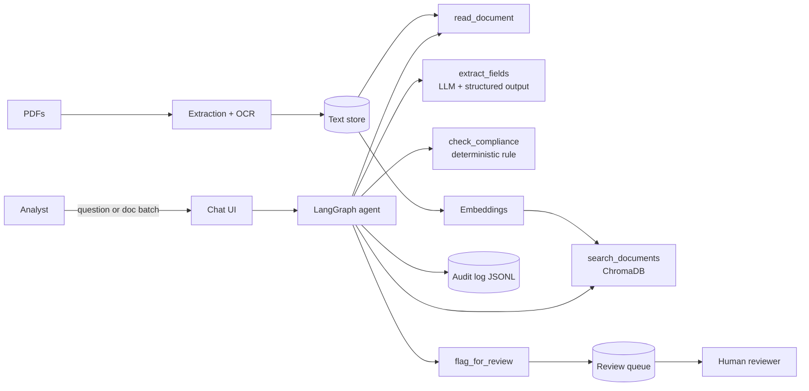

# Solution Architecture

## Diagram

## Design decisions (fill in the reasoning, this is what interviewers ask about)

| Decision | Chosen | Alternatives considered | Why |
|---|---|---|---|
| Who decides compliance | Deterministic rule | LLM judges directly | |
| Where the LLM is used | Field extraction + Q&A only | Everywhere | |
| Retrieval vs direct read | Direct read for single docs, RAG for cross-doc questions | RAG for everything | |
| Orchestration | LangGraph | Plain loop, CrewAI | |
| Human-in-the-loop | Graph interrupt before `review` | Post-hoc reporting | |
| Deployment target | | | |

## Non-functional
- Cost per 1,000 docs: (from eval)
- Latency per doc: (from eval)
- Scaling: what breaks first at 10× volume
