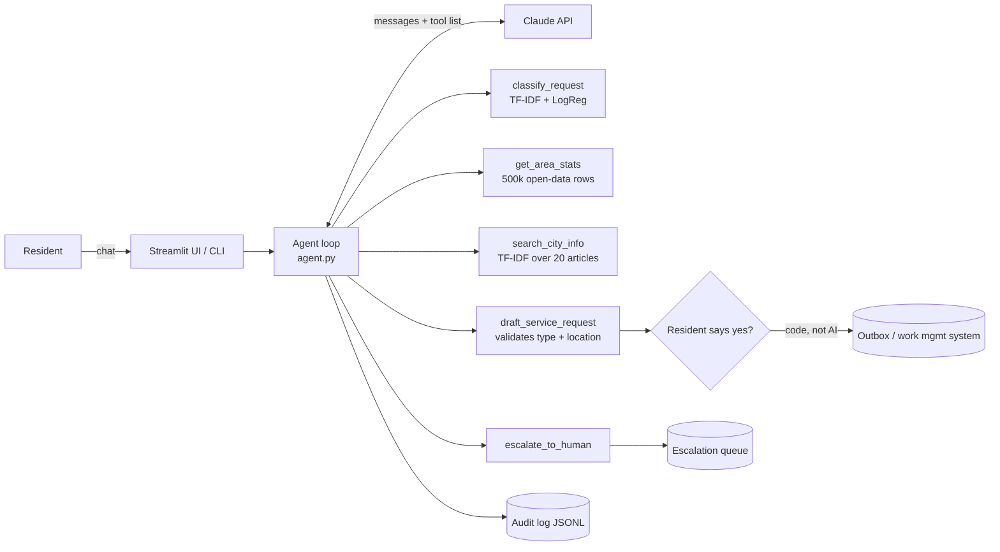

# Solution Architecture

## Design decisions

| Decision | Chosen | Alternatives | Why |
|---|---|---|---|
| Agent framework | Hand-written loop (~60 lines) | LangGraph, SDK tool runner | Every step visible and testable; nothing hidden. LangGraph becomes worth it with branching workflows or persistence. |
| Who submits | Plain code after "yes" | A `submit` tool for Claude | Takes the AI out of the only irreversible step; prompt injection can't trigger it |
| Classification | Classic ML model as a tool, Claude decides | Claude alone; classifier alone | Classifier is free and gives a confidence signal; Claude handles context, clarifying and overrides |
| Retrieval | TF-IDF + cosine similarity | Embeddings + vector DB | 20 articles: a vector database adds cost and moving parts with no measured benefit (85% hit@1 already) |
| Character n-grams | `char_wb` 3–5 | Word n-grams | Typos: 94% vs 69%. Retrieval: 85% vs 75% hit@1 |
| Area stats | Python `Counter` over cached rows | Database | One year of data fits in memory; ~13 s load once at startup |
| Testing the loop | Fake Claude in unit tests + paid scenario eval | Only manual testing | Free, repeatable tests for logic; scenario eval for real model behaviour |

## Production changes (not built)
- Replace local CSV with a scheduled refresh from the open data API, stored in a database.
- Replace the outbox file with the City's work-management API.
- Replace the demo knowledge base with official content and re-run the retrieval eval.
- Add streaming responses, rate limiting and conversation retention policies.
- Move evaluation into CI so every prompt or model change is scored before release.
